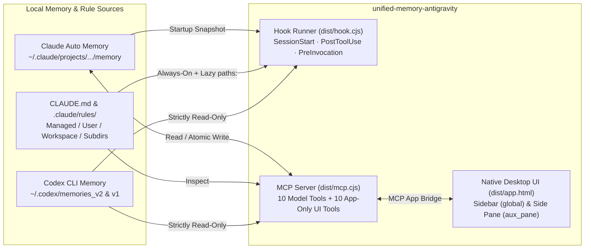

<div align="center">


# Unified Memory for Antigravity

**One unified memory layer for Antigravity Desktop & CLI — bridging Claude Code Auto Memory & Rules (Read-Write) with OpenAI Codex CLI Memory (Strictly Read-Only), plus a native MCP App dashboard.**

<p>
  
  
  
  
  
</p>

<p>
  <strong>English</strong> · <a href="./README.zh-CN.md">简体中文</a>
</p>

<p>
  <a href="#at-a-glance">At a Glance</a> ·
  <a href="#quick-start">Quick Start</a> ·
  <a href="#how-it-works">How It Works</a> ·
  <a href="#features">Features</a> ·
  <a href="#tools-skills--rules">Tools &amp; Skills</a> ·
  <a href="#configuration">Configuration</a>
</p>

</div>

---

## At a Glance

| Layer | Mode | Source | What It Brings to Antigravity |
| --- | --- | --- | --- |
| **Claude Auto Memory** | `Read-Write` | `~/.claude/projects/<slug>/memory/` | Exact v2.1.x path slug & Git worktree mapping, nested `metadata:` frontmatter, atomic writes + cross-process lockfile, 200-line / 25 KB `MEMORY.md` cap |
| **`CLAUDE.md` & `.claude/rules/`** | `Read + Lazy` | Managed → User → Ancestor → Project → Local | Multi-root workspaces, `@import` expansion, `AGENTS.md` dedup, HTML comment stripping, on-demand `paths:` glob & subdir `CLAUDE.md` injection |
| **OpenAI Codex CLI Memory** | `Read-Only` | `~/.codex/memories_v2/` & `memories/` | Startup `memory_summary.md` injection, search across `extensions/ad_hoc/`, `rollout_summaries/`, `skills/`, and v1 `MEMORY.md` with hard path-jail protection |
| **Desktop Dashboard** | `MCP App UI` | Left Sidebar & Side Pane `+` Menu | Native light/dark theme sync across 4 tabs: **Overview**, **Claude Memory**, **Codex Memory (RO)**, and **Rules & Context** |

---

## Quick Start

> [!TIP]
> Pre-bundled, zero-dependency runtime bundles (`dist/hook.cjs`, `dist/mcp.cjs`, `dist/app.html`) are committed in this repo — installing requires only **Node.js 20+** and **zero compilation**.

### Install via Antigravity CLI

```bash
agy plugin install https://github.com/A-Cepheus/unified-memory-antigravity
```

### Or Clone & Symlink Locally

```bash
git clone https://github.com/A-Cepheus/unified-memory-antigravity.git
cd unified-memory-antigravity
ln -s "$(pwd)" ~/.gemini/config/plugins/unified-memory-antigravity
```

Antigravity discovers the plugin automatically without restarting. Open **Unified Memory** from the **left sidebar** or the **side pane `+` menu**.

---

## How It Works



### Prompt Cache & Session Discipline

> [!IMPORTANT]
> Designed to keep multi-turn KV / prompt cache hit rates high:
> - **Deterministic Startup Snapshot**: `SessionStart` sorts multi-root `workspacePaths` deterministically and injects baseline memory/rules once per session (idempotent).
> - **Mid-Session Freeze**: Aligned with Claude Code and Codex CLI, root `CLAUDE.md`, `MEMORY.md`, and Codex `memory_summary.md` are **never** silently hot-reloaded mid-session — preventing unnecessary uncached token churn.
> - **Automatic `/compact` Reload**: Detects context compaction and cleanly re-injects the refreshed baseline into the compacted trajectory.
> - **Append-Only Lazy Injection**: Path-scoped `.claude/rules/` and subdirectory `CLAUDE.md` files are appended once when matching files are touched, preserving prior prefix caching.

---

## Features

### 1. Claude Code Auto Memory (`Read-Write`, v2.1.x Aligned)
- **Exact Project Slug & Worktree Resolution**: Matches Claude Code's slug algorithm (`[^a-zA-Z0-9]` → `-`, deterministic base36 hash suffix over 200 chars) and resolves linked Git worktrees back to the main repository root.
- **Dual-Schema Frontmatter**: Reads both legacy flat frontmatter and latest v2.1.x nested `metadata: { node_type: memory, type, originSessionId, modified }` topic files; writes v2.1.x nested metadata cleanly.
- **Concurrency & Budget Safety**: Cross-process lockfile + atomic writes, automatic `MEMORY.md` index sync, and strict **200-line / 25 KB** startup truncation (whichever comes first).
- **Native Settings Respect**: Honors `CLAUDE_CONFIG_DIR`, `CLAUDE_CODE_DISABLE_AUTO_MEMORY`, `autoMemoryEnabled`, and `autoMemoryDirectory`.

### 2. `CLAUDE.md` & `.claude/rules/` (Claude Code Parity)
- **Full Scope Hierarchy**: Loads `Managed → User → Ancestor → Project → CLAUDE.local.md` across multi-root workspaces.
- **Smart Parsing**: Expands `@import` up to 5 hops (with cycle detection and fenced code-block skipping), strips HTML comments outside code blocks, applies `claudeMdExcludes`, and deduplicates `@AGENTS.md` imports already loaded natively by Antigravity.
- **Two-Stage Lazy Loading**: `PostToolUse` (`read_file|edit_file|write_file`) queues matching `paths:` rules (`**` + `{a,b}` brace expansion) and subdirectory `CLAUDE.md` files; `PreInvocation` delivers them on the next model turn.

### 3. OpenAI Codex CLI Memory (`Strictly Read-Only`)
- **v2 + v1 Compatibility**: Prefers `~/.codex/memories_v2/` with fallback to `~/.codex/memories/`, automatically stripping the leading `v1` version header from `memory_summary.md`.
- **Cross-Session Retrieval**: Browses and searches `memory_summary.md`, `extensions/ad_hoc/`, `rollout_summaries/`, `skills/`, and chunked v1 `MEMORY.md`.
- **Zero Writes**: Enforced path jail with no write paths into `~/.codex/`.

### 4. Native Antigravity Desktop UI (MCP App)
- Mounts natively in both the **left sidebar** (`global`) and **side pane `+` menu** (`aux_pane`), automatically syncing light/dark host themes.
- **4 Tabs**:
  - **Overview** — Claude/Codex inventory, runtime config toggles, recent sessions, and live hook diagnostics.
  - **Claude Memory** — Visual `MEMORY.md` editor and full topic CRUD (create, edit, filter by type, delete).
  - **Codex Memory (RO)** — Read-only `memory_summary.md` preview, directory browser, and full-text search.
  - **Rules & Context** — Inspect active `CLAUDE.md` layers, `@import` chains, conditional `paths:` rules, and deduplicated `AGENTS.md`.

---

## Tools, Skills & Rules

### Model-Facing MCP Tools (10)

| Tool | Access | Description |
| --- | --- | --- |
| `open_memory_dashboard` | UI | Open the native Unified Memory dashboard (supports target tab / project path) |
| `claude_memory_status` | Read | Resolve project slug, Git worktree root, `MEMORY.md` stats, and topic counts |
| `claude_memory_list` | Read | List Claude Auto Memory topic files and index status |
| `claude_memory_read` | Read | Read `MEMORY.md` or a specific topic file with parsed metadata |
| `claude_memory_save` | Write | Atomically create/update a v2.1.x topic memory and sync `MEMORY.md` |
| `claude_memory_delete` | Write | Delete a topic memory and prune its entry from `MEMORY.md` |
| `claude_rules_inspect` | Read | Inspect active `CLAUDE.md`, `@import` graph, and `.claude/rules/` for a workspace |
| `codex_memory_summary` | Read | Read Codex `memory_summary.md` (read-only) |
| `codex_memory_search` | Read | Search Codex rollouts, extensions, skills, and handbook (read-only) |
| `codex_memory_read` | Read | Read a single Codex memory file inside the allowed path jail (read-only) |

> [!NOTE]
> Ten additional `ui_*` tools power the embedded MCP App and are tagged `visibility: ["app"]`, keeping them completely hidden from the model's tool context.

### Bundled Skills & Standing Rules
- **`memory-manage`** (`skills/memory-manage/SKILL.md`) — Interactive status, rule-loading diagnostics, and dashboard walkthrough (equivalent to Claude Code's `/memory`).
- **`memory-dream`** (`skills/memory-dream/SKILL.md`) — Consolidate, deduplicate, and prune stale Claude memories to keep `MEMORY.md` healthy under 200 lines / 25 KB.
- **`rules/AGENTS.md`** — Standing guidelines encoding Claude Code's 4-category memory discipline (`user`, `feedback`, `project`, `reference`) and read-only Codex rules.

---

## Configuration

Settings are persisted at `~/.gemini/antigravity/plugin_data/unified-memory-antigravity/config.json` (editable live in the **Overview** tab):

| Key | Default | Description |
| --- | --- | --- |
| `injectCodexSummaryOnStart` | `true` | Inject Codex `memory_summary.md` during `SessionStart` |
| `codexSummaryMaxBytes` | `8192` | Maximum bytes injected from Codex `memory_summary.md` |
| `injectCodexGlobalAgentsMd` | `false` | Also inject `~/.codex/AGENTS.md` (and `AGENTS.override.md`) at startup |
| `deduplicateNativeAgentsMd` | `true` | Skip `@AGENTS.md` imports already loaded natively by Antigravity |
| `maxStartupInjectBytes` | `65536` | Upper bound for combined `SessionStart` system injection |

<details>
<summary><strong>Environment Variables</strong></summary>

| Variable | Default | Purpose |
| --- | --- | --- |
| `CLAUDE_CONFIG_DIR` | `~/.claude` | Custom Claude Code configuration root |
| `CLAUDE_CODE_DISABLE_AUTO_MEMORY` | unset | Set `1` or `true` to disable Claude Auto Memory injection |
| `CODEX_HOME` | `~/.codex` | Custom Codex CLI home directory |
| `PLUGIN_DATA` | `~/.gemini/antigravity/plugin_data/unified-memory-antigravity` | Custom plugin config, session state, and diagnostics directory |

</details>

---

## Project Structure & Development

<details>
<summary><strong>Directory Layout</strong></summary>

```text
unified-memory-antigravity/
├── plugin.json             # Antigravity plugin manifest
├── hooks.json              # SessionStart / PostToolUse (file tools) / PreInvocation
├── mcp_config.json         # Stdio MCP server (${PLUGIN_ROOT}/dist/mcp.cjs)
├── assets/logo.svg         # Plugin vector logo
├── rules/AGENTS.md         # Standing memory hygiene guidelines
├── skills/
│   ├── memory-manage/      # Interactive status & rule inspection skill
│   └── memory-dream/       # Consolidation & pruning skill
├── src/
│   ├── core/               # Host-agnostic engine (Claude memory/rules, Codex RO, session state)
│   ├── hook/               # Antigravity hook runner
│   ├── mcp/                # Stdio MCP server + MCP App resource & app-only endpoints
│   └── ui/                 # React + @modelcontextprotocol/ext-apps single-file Desktop UI
├── tests/                  # Core unit tests & bundled dist/ E2E tests
└── dist/                   # Pre-bundled zero-dependency runtime artifacts
    ├── hook.cjs
    ├── mcp.cjs
    └── app.html
```

</details>

```bash
npm install
npm run typecheck
npm run build
npm test
```

- **100% Local**: All reading, writing, and indexing happen locally on your filesystem — zero telemetry, zero external network calls.
- Contributions and issue reports are welcome.
