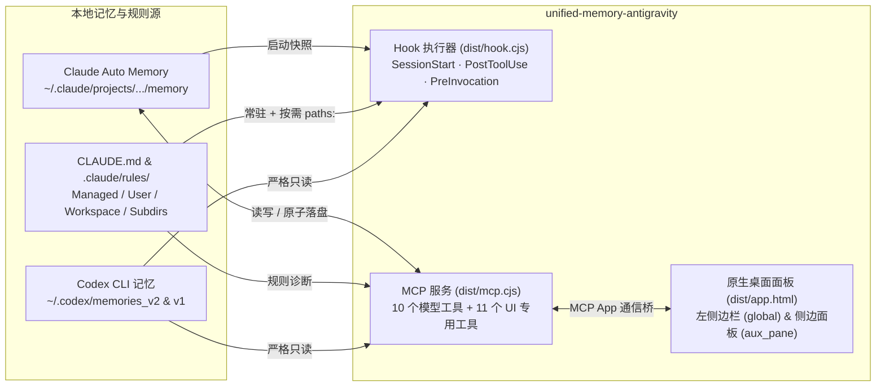

<div align="center">


# Unified Memory for Antigravity

**面向 Antigravity Desktop 与 CLI 的统一记忆层 —— 完整打通 Claude Code 自动记忆与规则（读写）和 OpenAI Codex CLI 记忆（严格只读），内置原生 MCP App 桌面管理面板。**

<p>
  
  
  
  
  
  <a href="./LICENSE"></a>
</p>

<p>
  <a href="./README.md">English</a> · <strong>简体中文</strong>
</p>

<p>
  <a href="#能力总览">能力总览</a> ·
  <a href="#快速安装">快速安装</a> ·
  <a href="#工作原理">工作原理</a> ·
  <a href="#核心特性">核心特性</a> ·
  <a href="#工具技能与规范">工具与技能</a> ·
  <a href="#配置说明">配置说明</a> ·
  <a href="#免责声明与开源协议">开源协议</a>
</p>

</div>

---

## 能力总览

| 记忆 / 规则层 | 权限模式 | 数据来源 | 为 Antigravity 带来的能力 |
| --- | --- | --- | --- |
| **Claude Auto Memory** | `读写` | `~/.claude/projects/<slug>/memory/` | 对齐 v2.1.x 路径编码与 Git worktree 主仓解析、嵌套 `metadata:` Frontmatter、跨进程锁 + 原子写入、`MEMORY.md` 200 行 / 25 KB 截断预算 |
| **`CLAUDE.md` & `.claude/rules/`** | `只读 + 懒加载` | Managed → User → Ancestor → Project → Local | 多根工作区、`@import` 递归展开、`AGENTS.md` 原生去重、HTML 注释剥离、`paths:` 通配符与子目录 `CLAUDE.md` 按需注入 |
| **OpenAI Codex CLI 记忆** | `严格只读` | `~/.codex/memories_v2/` 与 `memories/` | 启动注入 `memory_summary.md`，跨会话搜索 `extensions/ad_hoc/`、`rollout_summaries/`、`skills/` 与 v1 `MEMORY.md`，路径沙箱零写入 |
| **原生桌面管理面板** | `MCP App UI` | 左侧边栏 & 右侧辅助栏 `+` 菜单 | 自动同步深浅色主题，内置 **Overview**、**Claude Memory**、**Codex Memory (RO)**、**Rules & Context** 四个视图 |

---

## 快速安装

> [!TIP]
> 仓库已提交零依赖预构建单文件产物（`dist/hook.cjs`、`dist/mcp.cjs`、`dist/app.html`），安装只需 **Node.js 20+**，**无需 `npm install` 或本地编译**。

### 方式一：通过 Antigravity CLI 从 GitHub 直装（推荐）

```bash
agy plugin install https://github.com/A-Cepheus/unified-memory-antigravity
```

### 方式二：克隆后通过 CLI 本地安装

```bash
git clone https://github.com/A-Cepheus/unified-memory-antigravity.git
agy plugin install ./unified-memory-antigravity
```

### 方式三：手动 / 开发安装（全局或项目级）

- **全局安装（所有工作区生效）** —— 软链或复制到 `~/.gemini/config/plugins/`：

  ```bash
  git clone https://github.com/A-Cepheus/unified-memory-antigravity.git
  ln -s "$(pwd)/unified-memory-antigravity" ~/.gemini/config/plugins/unified-memory-antigravity
  ```

- **项目级安装（团队随仓库共享）** —— 将插件目录放入 `<repo>/.agents/plugins/unified-memory-antigravity/`。

Antigravity 无需重启即可自动发现插件。安装完成后，从 **左侧边栏** 或 **右侧辅助栏 `+` 菜单** 即可打开 **Unified Memory**。

---

## 工作原理



### Prompt Cache 与会话生命周期设计

> [!IMPORTANT]
> 专为高 Prompt Cache / KV Cache 命中率设计：
> - **确定性启动快照**：`SessionStart` 对多根 `workspacePaths` 做稳定排序，每个会话仅幂等注入一次基线记忆与常驻规则。
> - **会话中段冻结**：与 Claude Code 及 Codex CLI 保持一致，会话中途**不会**静默热重载根 `CLAUDE.md`、`MEMORY.md` 或 Codex `memory_summary.md`，避免无谓消耗非缓存 Token。
> - **`/compact` 自动重载**：检测到上下文压缩后，自动将最新基线重新注入压缩后的对话上下文。
> - **追加式按需注入**：命中 `paths:` 的条件规则和子目录 `CLAUDE.md` 仅在触达相关文件时以追加方式注入一次，不破坏历史前缀缓存。

---

## 核心特性

### 1. Claude Code 自动记忆（`读写`，对齐 v2.1.x）
- **精确项目编码与 Worktree 解析**：复刻 Claude Code 路径 slug 编码（`[^a-zA-Z0-9]` → `-`，超 200 字符附加确定性 base36 哈希后缀），并将 Git worktree 正确映射回主仓库根目录。
- **双 Schema Frontmatter 兼容**：读取兼容旧版扁平 Frontmatter 与最新 v2.1.x 嵌套 `metadata: { node_type: memory, type, originSessionId, modified }` 主题文件；写入统一生成 v2.1.x 嵌套格式。
- **并发安全与预算控制**：跨进程锁文件 + 原子写入、自动维护 `MEMORY.md` 索引，并严格执行 **200 行 / 25 KB** 启动截断上限（先到为准）。
- **原生配置兼容**：遵循 `CLAUDE_CONFIG_DIR`、`CLAUDE_CODE_DISABLE_AUTO_MEMORY`、`autoMemoryEnabled` 与 `autoMemoryDirectory`。

### 2. `CLAUDE.md` 与 `.claude/rules/`（对齐 Claude Code 语义）
- **完整层级加载**：跨多根工作区按 `Managed → User → Ancestor → Project → CLAUDE.local.md` 顺序加载。
- **智能解析与去重**：支持最多 5 跳 `@import` 展开（含循环检测与代码块跳过）、剔除代码块外的 HTML 注释、应用 `claudeMdExcludes`，并对 Antigravity 原生加载的 `@AGENTS.md` 自动去重。
- **外部导入与软链授权边界**：区分用户级/策略级规则（`~/.claude/CLAUDE.md`、`~/.claude/rules/`，默认可信）与仓库级规则（`CLAUDE.md`、`.claude/CLAUDE.md`、`.claude/rules/`、`CLAUDE.local.md`、子目录/祖先规则）。仓库级规则指向工作区外的 `@import` 或规则符号链接默认拦截，可在对模型隐藏的 **Rules & Context** 面板按文件/目录授权，同时自动只读兼容 Claude Code `~/.claude.json` 中已批准的项目。
- **两阶段懒加载**：`PostToolUse`（`read_file|edit_file|write_file`）匹配命中的 `paths:` 规则（支持 `**` 与 `{a,b}` 展开）和子目录 `CLAUDE.md` 入队，`PreInvocation` 在下一轮模型调用前精准注入。

### 3. OpenAI Codex CLI 记忆（`严格只读`）
- **v2 + v1 双代兼容**：优先读取 `~/.codex/memories_v2/` 并自动回退至 `~/.codex/memories/`，自动剔除 `memory_summary.md` 首行的 `v1` 版本标记。
- **跨会话检索**：支持浏览和搜索 `memory_summary.md`、`extensions/ad_hoc/`、`rollout_summaries/`、`skills/` 与分块 v1 `MEMORY.md`。
- **绝对只读保障**：强制路径沙箱校验，对 `~/.codex/` 零写入路径。

### 4. 原生 Antigravity 桌面面板（MCP App）
- 同时挂载在 **左侧边栏**（`global`）与 **右侧辅助栏 `+` 菜单**（`aux_pane`），自动跟随宿主浅色/深色主题。
- **四大视图**：
  - **Overview** — Claude / Codex 记忆总览、运行配置开关、近期会话与 Hook 实时诊断日志。
  - **Claude Memory** — `MEMORY.md` 可视化编辑与主题记忆完整增删改查（按分类筛选）。
  - **Codex Memory (RO)** — `memory_summary.md` 只读预览、目录浏览与全文关键词检索。
  - **Rules & Context** — 检查工作区生效的 `CLAUDE.md` 层级、`@import` 链、条件 `paths:` 规则及去重状态。

---

## 工具、技能与规范

### 模型可见 MCP 工具（10 个）

| 工具名 | 权限 | 说明 |
| --- | --- | --- |
| `open_memory_dashboard` | UI | 打开原生 Unified Memory 管理面板（支持指定标签页或项目路径） |
| `claude_memory_status` | 只读 | 解析项目 slug、Git worktree 主仓库根路径、`MEMORY.md` 统计与主题数 |
| `claude_memory_list` | 只读 | 列出 Claude Auto Memory 主题列表及索引状态 |
| `claude_memory_read` | 只读 | 读取 `MEMORY.md` 或指定主题文件及其解析后的元数据 |
| `claude_memory_save` | 写入 | 以 v2.1.x 格式原子创建/更新主题记忆并同步 `MEMORY.md` |
| `claude_memory_delete` | 写入 | 删除主题记忆并同步清理 `MEMORY.md` 对应条目 |
| `claude_rules_inspect` | 只读 | 检查工作区生效的 `CLAUDE.md`、`@import` 依赖链与 `.claude/rules/` |
| `codex_memory_summary` | 只读 | 读取 Codex `memory_summary.md` 全局摘要（只读） |
| `codex_memory_search` | 只读 | 搜索 Codex 历史 rollout、扩展笔记、技能与手册（只读） |
| `codex_memory_read` | 只读 | 读取允许路径沙箱内的单个 Codex 记忆文件（只读） |

> [!NOTE]
> 另有 11 个 `ui_*` 工具专供内嵌 MCP App 使用（含仅用户可操作的外部规则授权管理），均标记 `visibility: ["app"]`，对模型完全隐藏，不占用模型工具上下文。

### 内置技能与常驻规范
- **`memory-manage`**（`skills/memory-manage/SKILL.md`）—— 交互式记忆与规则诊断工作流（对标 Claude Code 的 `/memory`）。
- **`memory-dream`**（`skills/memory-dream/SKILL.md`）—— 整理、去重与清理过期 Claude 记忆，保持 `MEMORY.md` 控制在 200 行 / 25 KB 预算内。
- **`rules/AGENTS.md`** —— 常驻规范，引导 Agent 遵循 Claude Code 四类记忆纪律（`user`、`feedback`、`project`、`reference`）与 Codex 只读约束。

---

## 配置说明

运行配置持久化于 `~/.gemini/antigravity/plugin_data/unified-memory-antigravity/config.json`，也可在 UI 的 **Overview** 标签页直接调整：

| 配置项 | 默认值 | 说明 |
| --- | --- | --- |
| `injectCodexSummaryOnStart` | `true` | 是否在 `SessionStart` 注入 Codex `memory_summary.md` |
| `codexSummaryMaxBytes` | `8192` | 启动注入 Codex `memory_summary.md` 的最大字节数 |
| `injectCodexGlobalAgentsMd` | `false` | 是否同时在启动时注入 `~/.codex/AGENTS.md`（及 `AGENTS.override.md`） |
| `deduplicateNativeAgentsMd` | `true` | 是否跳过已被 Antigravity 原生加载的 `@AGENTS.md` 导入 |
| `trustClaudeCodeExternalApprovals` | `true` | 是否只读复用 `~/.claude.json` 中已在 Claude Code 批准的项目外部导入授权 |
| `externalRuleTrust` | `{}` | 按工作区保存的外部 `@import` / 规则软链精确白名单与黑名单（通过 UI 管理） |
| `maxStartupInjectBytes` | `65536` | `SessionStart` 合并注入内容的总字节上限 |

<details>
<summary><strong>支持的环境变量</strong></summary>

| 环境变量 | 默认值 | 说明 |
| --- | --- | --- |
| `CLAUDE_CONFIG_DIR` | `~/.claude` | 自定义 Claude Code 配置目录 |
| `CLAUDE_CODE_DISABLE_AUTO_MEMORY` | 未设置 | 设为 `1` 或 `true` 禁用 Claude Auto Memory 注入 |
| `CODEX_HOME` | `~/.codex` | 自定义 Codex CLI 根目录 |
| `PLUGIN_DATA` | `~/.gemini/antigravity/plugin_data/unified-memory-antigravity` | 自定义插件配置、会话状态与诊断日志目录 |

</details>

---

## 目录结构与开发

<details>
<summary><strong>目录结构</strong></summary>

```text
unified-memory-antigravity/
├── plugin.json             # Antigravity 插件清单
├── hooks.json              # SessionStart / PostToolUse（文件类工具）/ PreInvocation
├── mcp_config.json         # Stdio MCP 服务配置（${PLUGIN_ROOT}/dist/mcp.cjs）
├── assets/logo.svg         # 插件矢量 Logo
├── rules/AGENTS.md         # 常驻记忆使用与写入规范
├── skills/
│   ├── memory-manage/      # 记忆与规则检查技能
│   └── memory-dream/       # 记忆整理与去重技能
├── src/
│   ├── core/               # 宿主无关核心引擎（Claude 记忆/规则、Codex 只读、会话状态）
│   ├── hook/               # Antigravity Hook 入口
│   ├── mcp/                # Stdio MCP 服务 + MCP App 资源与 UI 专用接口
│   └── ui/                 # React + @modelcontextprotocol/ext-apps 单文件桌面 UI
├── tests/                  # 核心单元测试与打包产物端到端测试
└── dist/                   # 预构建零依赖运行产物
    ├── hook.cjs
    ├── mcp.cjs
    └── app.html
```

</details>

```bash
npm install
npm run typecheck
npm run build
npm test
```

- **100% 本地运行**：所有读写与检索均在本地文件系统完成，无遥测、无外部网络请求。
- 欢迎提交 Issue 与 Pull Request。

---

## 免责声明与开源协议

- **独立社区项目**：`unified-memory-antigravity` 为独立开源项目，与 Google、Anthropic 或 OpenAI 无隶属、背书或赞助关系；文中提及的产品名与商标归各自所有者所有。
- **仅限本地明文文件互操作**：本插件仅读写用户本机硬盘上的明文 Markdown 记忆与规则文件（`~/.claude/projects/*/memory/`、`CLAUDE.md`、`.claude/rules/` 以及严格只读的 `~/.codex/memories*`），**绝不**读取或复用任何账号凭据、API Key、OAuth Token 或私有云端接口。
- **跨模型数据流提示**：被注入到 Antigravity 会话中的本地记忆会随对话上下文发送至当前 Antigravity 所使用的模型服务商。若你处于企业数据隔离或 DPA 合规约束环境下，请先确认跨工具共享本地笔记符合所在组织政策（可在配置中设 `injectCodexSummaryOnStart: false` 关闭 Codex 注入，或设置 `CLAUDE_CODE_DISABLE_AUTO_MEMORY=1` 禁用 Claude 自动记忆注入）。
- **开源协议**：基于 [MIT License](./LICENSE) 发布。

